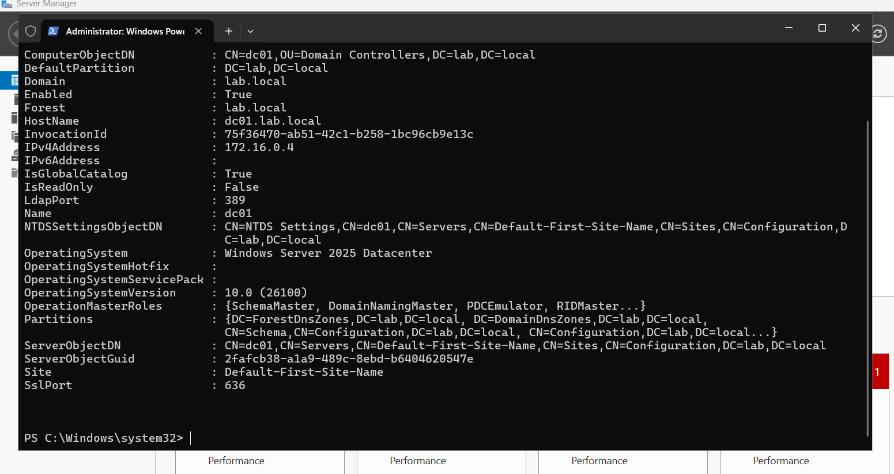
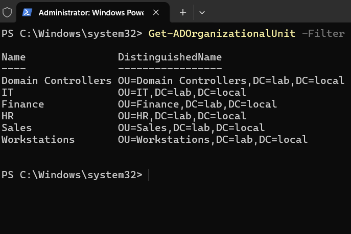
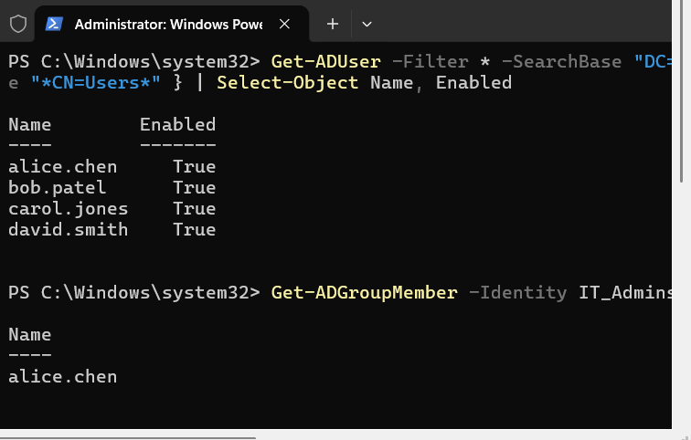
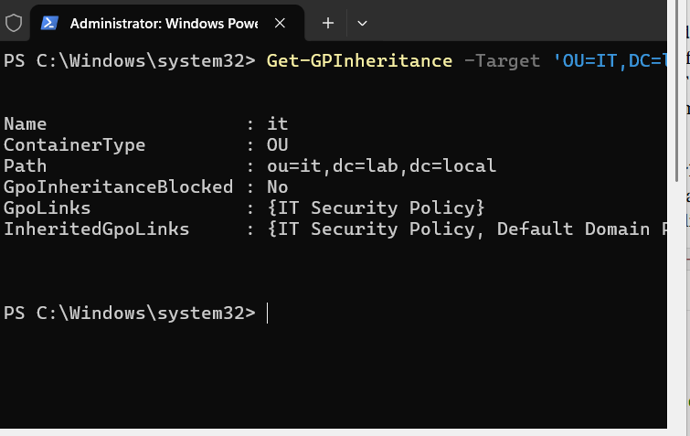
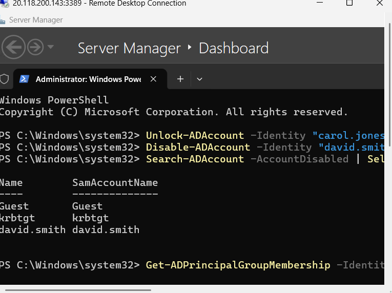

# Active Directory Lab

Built a Windows Server 2025 domain controller in Azure and configured users, groups, Group Policy, and common help desk tasks with PowerShell.

**Stack:** Windows Server 2025 · Azure VM · Active Directory Domain Services · Group Policy · PowerShell

## Objective

Active Directory controls who can access what in most enterprise Windows environments. This lab builds that foundation from scratch: a new domain, an OU structure that mirrors a real organization, role-based access through security groups, centrally enforced policy, and the account tasks help desk and sysadmin teams handle daily.

## Environment

| Item | Value |
|------|-------|
| Platform | Azure VM, Standard_B2s (2 vCPU, 4 GB RAM), Central US |
| OS | Windows Server 2025 Datacenter (Azure Edition, Gen2) |
| Domain | `lab.local` (NetBIOS: `LAB`) |
| Access | RDP via native Remote Desktop client |
| Cost control | VM deallocated between sessions, nightly auto-shutdown, RDP restricted to my IP; kept for later labs |

## What I Built

1. **Deployed the VM** in Azure and connected over RDP
2. **Installed AD DS and GPMC** with PowerShell
3. **Promoted the server to a domain controller** and created the `lab.local` forest
4. **Created 5 OUs** (IT, Finance, HR, Sales, Workstations)
5. **Created 4 security groups** and **4 user accounts**, one per department, with group-based access
6. **Created and linked a GPO** (`IT Security Policy`) to the IT OU
7. **Performed help desk tasks:** password reset, account unlock, offboarding, and audit reporting

## Key Commands

### Install roles and promote to domain controller

```powershell
Install-WindowsFeature -Name AD-Domain-Services -IncludeManagementTools
Install-WindowsFeature -Name GPMC

Install-ADDSForest -DomainName "lab.local" -DomainNetBiosName "LAB" `
  -InstallDns:$true -SafeModeAdministratorPassword (Read-Host -AsSecureString "DSRM password") `
  -Force:$true
```

The server restarts automatically when promotion finishes.

### Create OUs

```powershell
"IT","Finance","HR","Sales","Workstations" | ForEach-Object {
    New-ADOrganizationalUnit -Name $_ -Path "DC=lab,DC=local"
}
```

> I used `Workstations` instead of `Computers` because a new domain already has a built-in `Computers` container, and AD rejects an OU with the same name. That container also can't have a GPO linked to it, which is why organizations create their own OU for machines.

### Create security groups

```powershell
New-ADGroup -Name "IT_Admins"     -GroupScope Global -GroupCategory Security -Path "OU=IT,DC=lab,DC=local"
New-ADGroup -Name "Finance_Users" -GroupScope Global -GroupCategory Security -Path "OU=Finance,DC=lab,DC=local"
New-ADGroup -Name "HR_Users"      -GroupScope Global -GroupCategory Security -Path "OU=HR,DC=lab,DC=local"
New-ADGroup -Name "Sales_Users"   -GroupScope Global -GroupCategory Security -Path "OU=Sales,DC=lab,DC=local"
```

### Create users and assign groups

Run the whole block together. `$password` must be defined before `New-ADUser` runs.

```powershell
$password = Read-Host -AsSecureString "Initial password"

New-ADUser -Name "alice.chen" -GivenName "Alice" -Surname "Chen" -SamAccountName "alice.chen" -UserPrincipalName "alice.chen@lab.local" -Path "OU=IT,DC=lab,DC=local" -AccountPassword $password -Enabled $true
New-ADUser -Name "bob.patel" -GivenName "Bob" -Surname "Patel" -SamAccountName "bob.patel" -UserPrincipalName "bob.patel@lab.local" -Path "OU=Finance,DC=lab,DC=local" -AccountPassword $password -Enabled $true
New-ADUser -Name "carol.jones" -GivenName "Carol" -Surname "Jones" -SamAccountName "carol.jones" -UserPrincipalName "carol.jones@lab.local" -Path "OU=HR,DC=lab,DC=local" -AccountPassword $password -Enabled $true
New-ADUser -Name "david.smith" -GivenName "David" -Surname "Smith" -SamAccountName "david.smith" -UserPrincipalName "david.smith@lab.local" -Path "OU=Sales,DC=lab,DC=local" -AccountPassword $password -Enabled $true

Add-ADGroupMember -Identity "IT_Admins"     -Members "alice.chen"
Add-ADGroupMember -Identity "Finance_Users" -Members "bob.patel"
Add-ADGroupMember -Identity "HR_Users"      -Members "carol.jones"
Add-ADGroupMember -Identity "Sales_Users"   -Members "david.smith"
```

## Group Policy

GPO **IT Security Policy**, linked to the IT OU:

| Setting | Value | Purpose |
|---------|-------|---------|
| Minimum password length | 12 | Stronger passwords |
| Password complexity | Enabled | Upper, lower, number, symbol |
| Interactive logon: machine inactivity limit | 900 sec | Auto-lock after 15 minutes |
| Removable storage: deny all access | Enabled | Block USB data exfiltration |

> **Notes:**
> - All four settings are under Computer Configuration, so they apply to computer accounts in the IT OU. This lab has no computers in that OU yet (the only machine is the domain controller), so the policy is linked and configured but not yet applied to a workstation. Joining a workstation and moving it into the IT OU is listed under Next Steps.
> - Account Policy settings (password length and complexity) only govern domain accounts when set at the domain level, such as in the Default Domain Policy. In an OU-linked GPO they only affect local accounts on computers in that OU. The screen lock and USB settings apply as intended.

## Help Desk Tasks

```powershell
# Reset password and force change at next logon
Set-ADAccountPassword -Identity "bob.patel" -Reset -NewPassword (Read-Host -AsSecureString "New password")
Set-ADUser -Identity "bob.patel" -ChangePasswordAtLogon $true

# Unlock an account
Unlock-ADAccount -Identity "carol.jones"

# Offboarding: disable (not delete) to preserve history and group memberships
Disable-ADAccount -Identity "david.smith"
Search-ADAccount -AccountDisabled | Select-Object Name, SamAccountName

# Audit: accounts inactive for 90+ days
$cutoff = (Get-Date).AddDays(-90)
Get-ADUser -Filter {LastLogonDate -lt $cutoff -and Enabled -eq $true} -Properties LastLogonDate |
  Select-Object Name, LastLogonDate

# Group membership for a user
Get-ADPrincipalGroupMembership -Identity "alice.chen" | Select-Object Name
```

## Verification

| Check | Command | Expected |
|-------|---------|----------|
| DC running | `Get-ADDomainController` | Returns `dc01` in `lab.local` |
| OUs exist | `Get-ADOrganizationalUnit -Filter *` | 5 OUs plus Domain Controllers |
| Users enabled | `Get-ADUser -Filter {Enabled -eq $true}` | 4 test accounts |
| Group membership | `Get-ADGroupMember -Identity IT_Admins` | `alice.chen` |
| GPO linked | `Get-GPInheritance -Target 'OU=IT,DC=lab,DC=local'` | `IT Security Policy` |

## Screenshots

**Domain controller**



**OU structure**



**Users and groups**



**GPO linked to the IT OU**



**Help desk tasks**



## Troubleshooting Notes

| Problem | Fix |
|---------|-----|
| Promotion fails: DSRM password doesn't meet complexity requirements | The prerequisite check stops before changing anything. Rerun with 12+ characters including upper and lower case, a number, and a symbol. |
| `New-ADOrganizationalUnit` fails: name already in use (`Computers`) | A built-in `Computers` container already exists. Use a different OU name such as `Workstations`. |
| Password reset fails: doesn't meet length, complexity, or history requirement | Retry with a compliant password that isn't a recently used one. The domain checks all three. |
| PowerShell prompts for `Name:` when creating users | `$password` wasn't defined first. Run the full block together. |
| Can't copy/paste into the VM | In the RDP client: Show Options → Local Resources → check Clipboard. |
| Group Policy Settings tab is blocked by IE Enhanced Security | Check settings in the GPO editor instead, or turn off IE ESC for administrators on a lab VM. |
| Can't RDP after promotion | Sign in as `LAB\<admin username>`. |
| GPO not applying | Run `gpupdate /force`, then `gpresult /r` on the target machine. |

## What I Learned

- Access should be assigned to groups, never to individual users. That is what makes onboarding and offboarding fast and auditable.
- OUs are the unit of policy: one GPO linked to one OU applies to everyone inside it.
- Disabling accounts instead of deleting them preserves audit history.
- The promotion's prerequisite check validates the passwords and DNS setup before changing anything, so a failed check is safe to rerun.
- Password errors usually come from the domain policy's three checks: length, complexity, and history.

## Next Steps

- Join a workstation to the domain, move it into the IT OU, and verify the GPO applies
- Sync `lab.local` to Microsoft Entra ID with Entra Connect (hybrid identity)
- Build a tiered admin model (Tier 0/1/2)
- Automate bulk user provisioning from CSV
